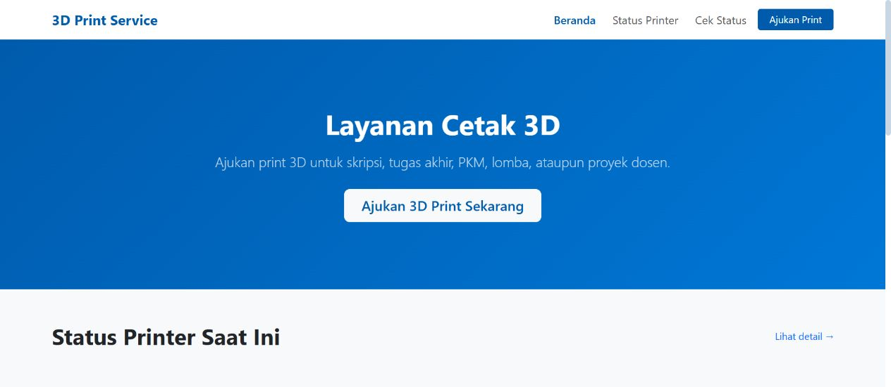

# 3D Print Service

Project website untuk mengelola layanan cetak 3D dari pengajuan sampai pesanan selesai. Pengguna mengirim detail pesanan dan admin mengatur biaya serta antrean pengerjaan.

## Tampilan beranda

## Fitur

1. Formulir pengajuan dengan tautan file cetak.
2. Pemeriksaan pengajuan dan penentuan biaya.
3. Antrean cetak dan pembaruan status pesanan.
4. Pengiriman bukti pembayaran dan konfirmasi oleh admin.
5. Invoice dan pencatatan transaksi.

## Cara kerja

Pengguna mengirim formulir pengajuan. Admin memeriksa file dan menentukan biaya. Setelah pembayaran dikonfirmasi, admin mengatur antrean dan memperbarui status sampai pesanan selesai.

## Kode project

Kode tersedia di `3d-print-service.zip`. Unduh lalu ekstrak arsip untuk membaca folder sumber.
